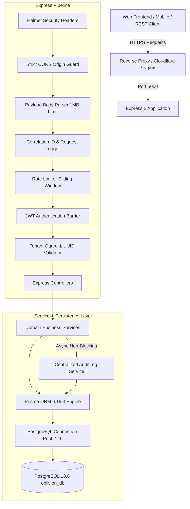
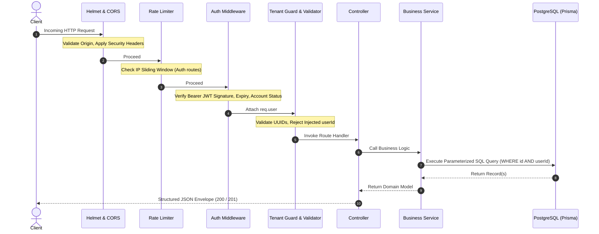
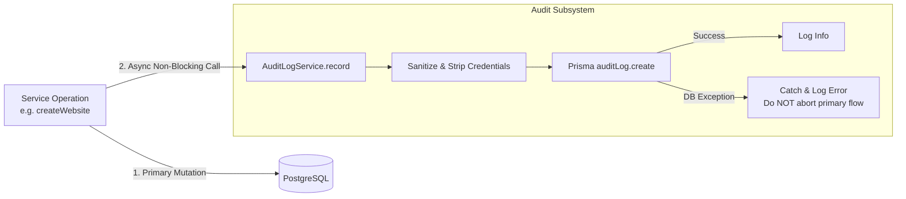
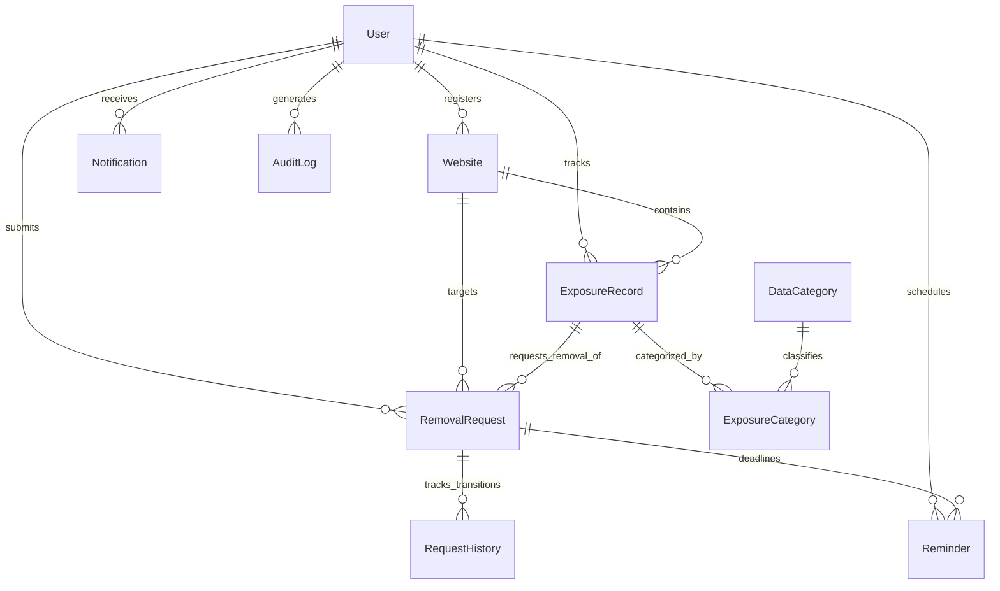

# OBLIVION – Backend Architecture & System Design

**Platform:** OBLIVION – The Internet's Forget Button  
**Target Environment:** Node.js 24 + Express 5 + TypeScript 5.7  
**Database:** PostgreSQL 18.6 via Prisma ORM 6.19.3  
**Design Pattern:** Layered Service-Repository Architecture with Strict Multi-Tenancy  
**Document Status:** Production Baseline Architecture

---

## 1. System Overview

OBLIVION is a high-assurance privacy management and right-to-be-forgotten orchestration platform. It enables individuals to catalog third-party websites holding their personal information, compute real-time privacy risk scores, submit formal erasure requests (GDPR Art. 17 / CCPA), track request histories, schedule statutory follow-up reminders, and audit all security operations.



---

## 2. Request Lifecycle

Every HTTP request undergoes a deterministic sequence of processing stages before touching domain services or database records:



---

## 3. Layered Responsibilities

| Layer | Files / Directory | Primary Responsibility |
| :--- | :--- | :--- |
| **Routing** | `src/routes/*.ts` | Defines URL paths, binds HTTP verbs, attaches rate limiters, auth middleware, and validation rules. |
| **Middleware** | `src/middleware/*.ts` | Cross-cutting concerns: security headers (`helmet`), CORS, body parsing, correlation logging, JWT validation, tenant parameter guarding, centralized error translation. |
| **Validators** | `src/validators/*.ts` | Declarative Zod schemas defining allowed body, query, and parameter shapes. Rejects unpermitted fields and clamps numerical boundaries. |
| **Controllers** | `src/controllers/*.ts` | HTTP transport translation: extracts validated parameters, delegates to service classes, and formats standard API JSON responses (`ApiResponse.success`). |
| **Services** | `src/services/*.ts` | Core business logic, risk score calculation, removal state transitions, atomic transactional coordination (`prisma.$transaction`), and audit event triggering. |
| **Data Access** | `src/lib/prisma.ts` | Prisma Client singleton managing PostgreSQL connection pooling, query logging, and lifecycle events (`SIGINT`/`SIGTERM`). |

---

## 4. Multi-Tenant Security & Tenant Isolation

Tenant isolation is implemented through a defense-in-depth model across the middleware, controller, and query layers:

### 1. Injected Identity Rejection
Clients can never specify `userId` or `user_id` in request bodies or query parameters. The middleware `rejectInjectedTenantFields` rejects any request attempting to submit a manual user identifier with `HTTP 422 Unprocessable Entity`.

### 2. Verified Token Identity
The caller's identity is derived solely from the cryptographically verified JWT payload (`decoded.sub`), confirmed against the database (`prisma.user.findUnique`), and injected into `req.user`.

### 3. Scoped Prisma Queries (`TenantGuard`)
All database access for user-owned records enforces composite filtering:
```typescript
const website = await prisma.website.findFirst({
  where: {
    id: websiteId,
    userId: req.user.id, // Strictly scoped to authenticated caller
  },
});
if (!website) {
  throw new NotFoundError('Website not found');
}
```
**Information Disclosure Prevention:** By returning `404 Not Found` rather than `403 Forbidden` for cross-tenant attempts, attackers cannot enumerate whether a resource UUID exists in another tenant's account.

---

## 5. Audit Logging Architecture

Security-critical operations asynchronously dispatch event records to the `AuditLogService`:



### Architectural Guarantees:
- **Non-Blocking Fault Tolerance:** Audit failures will never roll back or disrupt a user's primary business operation. If a database timeout occurs during an audit write, the error is caught and logged to system output.
- **Append-Only API Design:** The public API provides read and export endpoints only; audit log records can never be updated or deleted via API calls.
- **Privacy & Credential Scrubbing:** Passwords, hashes, JWT tokens, and authorization headers are scrubbed prior to persistence.

---

## 6. Database Entity-Relationship Architecture

The 10 relational models and their relationships are structured as follows:



### Referential Integrity Guarantees:
- **Cascading Purges (`onDelete: Cascade`):** Deleting a user account cascades to automatically purge all associated websites, exposure records, categories, removal requests, histories, reminders, notifications, and audit logs, leaving **zero orphaned records**.
- **Atomic Transactions (`prisma.$transaction`):** Multi-table mutations—such as transitioning a removal request status and creating its corresponding immutable `request_history` entry—execute within atomic database transactions.
