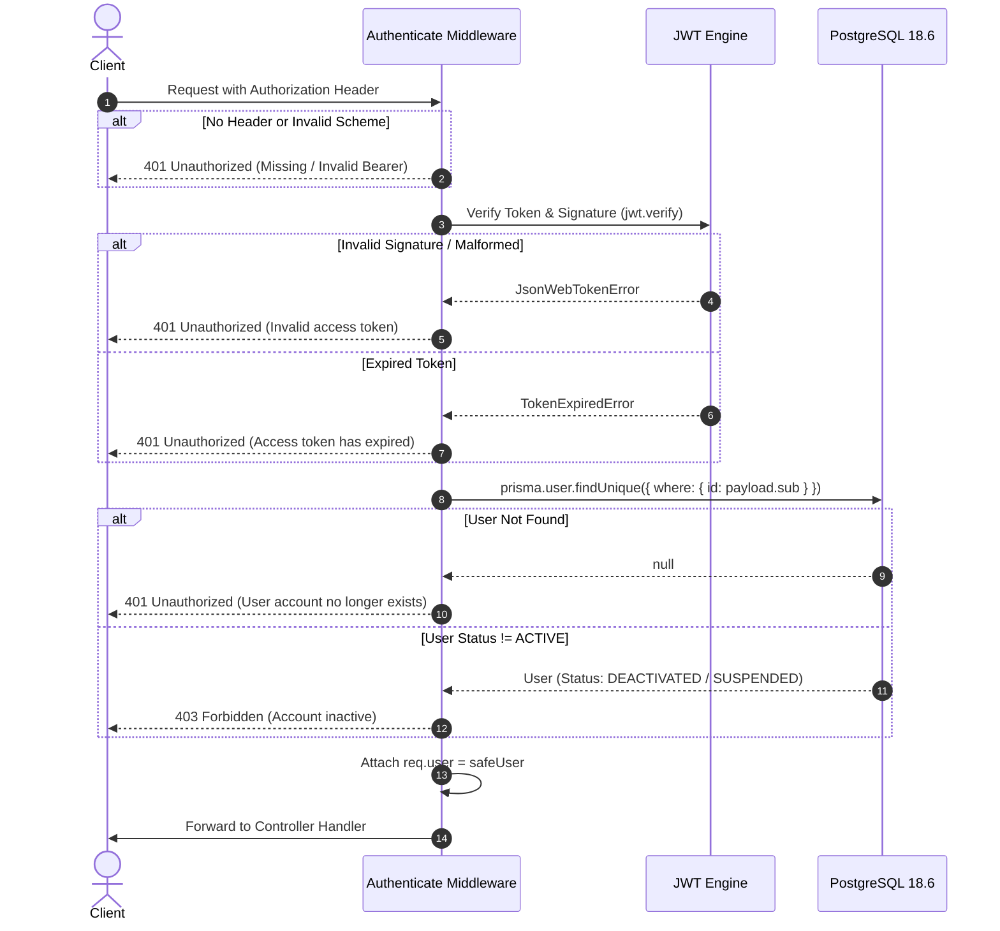

# OBLIVION – Authentication & Identity Architecture (Phase 2)

**Platform:** OBLIVION – The Internet's Forget Button  
**Engine:** Node.js 24 + Express 5 + TypeScript  
**Database:** PostgreSQL 18.6 via Prisma ORM 6.19.3  
**Status:** Implemented & Verified  

---

## 1. Architectural Overview

The OBLIVION authentication system provides secure, stateless identity management designed specifically for high-sensitivity privacy and data-forgetting platforms. It integrates zero-trust principles:
- **Stateless Bearer JWT Tokens**: Cryptographically signed access tokens containing standard (`sub`) and user identification claims.
- **Strict Input Validation**: Zod-powered schema validation with mass-assignment defense.
- **Strong Cryptographic Password Hashing**: `bcryptjs` with a work factor of 12 rounds.
- **Account Lifecycle Enforcement**: Real-time account status checks preventing deactivated or suspended accounts from authenticating or accessing protected resources.
- **Zero Credential Leakage**: Database models, service layers, and response serializers guarantee that password hashes are never exposed in JSON responses or log pipelines.

---

## 2. Database Model & Enums

Authentication directly targets the PostgreSQL `users` table via Prisma ORM:

```prisma
enum AccountStatus {
  ACTIVE
  SUSPENDED
  DEACTIVATED
  PENDING_VERIFICATION
}

model User {
  id           String        @id @default(dbgenerated("gen_random_uuid()")) @db.Uuid
  fullName     String        @map("full_name") @db.VarChar(255)
  email        String        @unique @db.VarChar(255)
  passwordHash String        @map("password_hash") @db.VarChar(255)
  accountStatus AccountStatus @default(ACTIVE) @map("account_status")
  createdAt    DateTime      @default(now()) @map("created_at") @db.Timestamptz(6)
  updatedAt    DateTime      @updatedAt @map("updated_at") @db.Timestamptz(6)

  // Relational links
  websites        Website[]
  exposureRecords ExposureRecord[]
  removalRequests RemovalRequest[]

  @@map("users")
}
```

---

## 3. Cryptography & Security Controls

### 3.1. Password Hashing (bcryptjs)
- **Work factor**: 12 salt rounds (adaptive cost factor balanced for high security against offline brute-force attacks).
- **Asymmetric processing**: Passwords are immediately hashed before insertion; raw plaintext passwords never leave the transient controller scope.
- **Database storage**: Stored in `password_hash` (`$2b$12$...`).

### 3.2. JWT Token Issuance & Claims
- **Algorithm**: HS256 (HMAC SHA-256) using a 256-bit cryptographically secure secret from `JWT_SECRET`.
- **Expiration**: 7 days (`JWT_EXPIRES_IN=7d`), configurable through environment variables.
- **Token Claims Payload**:
  ```json
  {
    "sub": "3df8c206-e65a-49a8-a16a-11899ddc7b62",
    "email": "user@domain.com",
    "iat": 1793692890,
    "exp": 1794297690
  }
  ```

### 3.3. Mass-Assignment & Schema Defense
Using Zod schema validation with `.strict()` enforcement:
- Prevents injection of client-supplied fields such as `role`, `accountStatus`, `id`, `createdAt`, or `passwordHash`.
- Email normalization via `.trim().toLowerCase()` prevents duplicate account creation through case sensitivity variations.
- Rejects non-conforming types and payload structures with HTTP 422 Unprocessable Entity.

### 3.4. Account Enumeration & Information Disclosure Prevention
- Login failure returns a uniform message: `"Invalid email or password"` whether the email does not exist or the password is incorrect.
- Response timings and messages provide no distinction between invalid credentials and non-existent users.

---

## 4. Endpoints & API Specification

Base path: `/api/v1/auth`

### 4.1. User Registration
`POST /api/v1/auth/register`

Creates a new user account with default `ACTIVE` status and returns initial access credentials.

**Headers:**
```http
Content-Type: application/json
```

**Request Body:**
```json
{
  "fullName": "Jane Doe",
  "email": "jane.doe@example.com",
  "password": "SecurePassword2026!"
}
```

**Success Response (201 Created):**
```json
{
  "success": true,
  "statusCode": 201,
  "message": "User registered successfully",
  "data": {
    "user": {
      "id": "3df8c206-e65a-49a8-a16a-11899ddc7b62",
      "fullName": "Jane Doe",
      "email": "jane.doe@example.com",
      "accountStatus": "ACTIVE",
      "createdAt": "2026-11-03T08:01:30.483Z",
      "updatedAt": "2026-11-03T08:01:30.483Z"
    },
    "tokens": {
      "accessToken": "eyJhbGciOiJIUzI1NiIsInR5cCI6IkpXVCJ9...",
      "tokenType": "Bearer",
      "expiresIn": "7d"
    }
  },
  "timestamp": "2026-11-03T08:01:30.483Z"
}
```

**Common Error Responses:**
- `422 Unprocessable Entity`: Validation failure (e.g. invalid email format, password under 8 characters, missing fields, or unrecognized keys).
- `409 Conflict`: Email address is already registered (`"An account with this email address already exists"`).

---

### 4.2. User Login
`POST /api/v1/auth/login`

Authenticates existing user credentials and generates a signed JWT token.

**Request Body:**
```json
{
  "email": "jane.doe@example.com",
  "password": "SecurePassword2026!"
}
```

**Success Response (200 OK):**
```json
{
  "success": true,
  "statusCode": 200,
  "message": "Login successful",
  "data": {
    "user": {
      "id": "3df8c206-e65a-49a8-a16a-11899ddc7b62",
      "fullName": "Jane Doe",
      "email": "jane.doe@example.com",
      "accountStatus": "ACTIVE",
      "createdAt": "2026-11-03T08:01:30.483Z",
      "updatedAt": "2026-11-03T08:01:30.483Z"
    },
    "tokens": {
      "accessToken": "eyJhbGciOiJIUzI1NiIsInR5cCI6IkpXVCJ9...",
      "tokenType": "Bearer",
      "expiresIn": "7d"
    }
  },
  "timestamp": "2026-11-03T08:01:30.804Z"
}
```

**Common Error Responses:**
- `401 Unauthorized`: `"Invalid email or password"` (generic error for invalid credentials or missing account).
- `403 Forbidden`: `"Your account has been deactivated. Please contact support"` (when `accountStatus !== 'ACTIVE'`).

---

### 4.3. Current User Profile
`GET /api/v1/auth/me`

Retrieves the authenticated user's profile based strictly on verified JWT token identity.

**Headers:**
```http
Authorization: Bearer <access_token>
```

**Success Response (200 OK):**
```json
{
  "success": true,
  "statusCode": 200,
  "message": "Current user profile retrieved",
  "data": {
    "id": "3df8c206-e65a-49a8-a16a-11899ddc7b62",
    "fullName": "Jane Doe",
    "email": "jane.doe@example.com",
    "accountStatus": "ACTIVE",
    "createdAt": "2026-11-03T08:01:30.483Z",
    "updatedAt": "2026-11-03T08:01:30.483Z"
  },
  "timestamp": "2026-11-03T08:01:31.131Z"
}
```

**Common Error Responses:**
- `401 Unauthorized`:
  - `"Authentication required: Missing Authorization header"`
  - `"Authentication failed: Invalid access token"`
  - `"Authentication failed: Access token has expired"`
- `403 Forbidden`: Account deactivated or suspended since token issuance.

---

## 5. Middleware Workflow (`authenticate`)



---

## 6. Implementation Summary

| Component | File Path | Description |
|:---|:---|:---|
| **Types** | `src/types/auth.types.ts` | Strict TypeScript models for auth payloads, tokens, and sanitization |
| **Validators** | `src/validators/auth.validator.ts` | Zod schema validation with `.strict()` injection protection |
| **Service** | `src/services/auth.service.ts` | Core business logic, bcrypt hashing, JWT token generation, database operations |
| **Middleware** | `src/middleware/authenticate.middleware.ts` | Token verification, payload parsing, real-time status validation |
| **Controller** | `src/controllers/auth.controller.ts` | HTTP request handling and response envelope standardization |
| **Routes** | `src/routes/auth.routes.ts` | Endpoint routing mounted under `/api/v1/auth` |
| **Tests** | `tests/auth.test.ts` | 14 automated integration tests executed against live PostgreSQL 18.6 |
