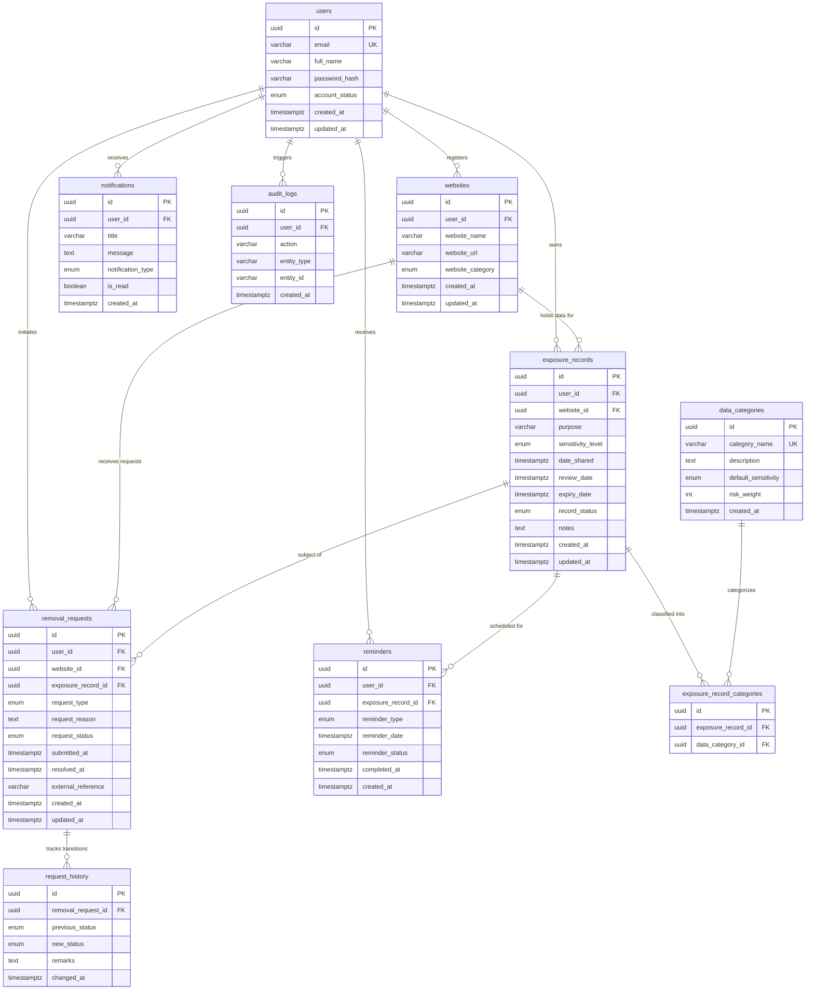

# OBLIVION – Database Relationships & Data Architecture

This document defines the entity-relationship model, cardinality rules, referential integrity actions, and tenant isolation architecture for **OBLIVION – The Internet's Forget Button**.

---

## 1. Entity-Relationship Diagram (ERD)

---

## 2. Cardinality & Relationship Breakdown

### 2.1 One User to Many Websites (`users 1 : N websites`)
- **Cardinality:** A user can register multiple external websites or services where their personal information exists.
- **Foreign Key:** `websites.user_id` -> `users.id`
- **Referential Action:** `ON DELETE CASCADE`
  - When a user invokes their right to account deletion on OBLIVION, their registered website portfolio is automatically purged.
- **Uniqueness:** `UNIQUE (user_id, website_url)` prevents a user from duplicating the same website entry.

### 2.2 One User to Many Exposure Records (`users 1 : N exposure_records`)
- **Cardinality:** A user maintains multiple exposure records in their personal privacy ledger.
- **Foreign Key:** `exposure_records.user_id` -> `users.id`
- **Referential Action:** `ON DELETE CASCADE`
  - Deleting the user purges their exposure records.

### 2.3 One Website to Many Exposure Records (`websites 1 : N exposure_records`)
- **Cardinality:** A single website can have multiple exposure records (e.g., account created in 2021, job application submitted in 2023).
- **Foreign Key:** `exposure_records.website_id` -> `websites.id`
- **Referential Action:** `ON DELETE RESTRICT`
  - A website cannot be deleted if active exposure records remain associated with it. This protects users from accidentally wiping exposure histories.

### 2.4 Many Exposure Records to Many Data Categories (`exposure_records M : N data_categories`)
- **Resolved via:** `exposure_record_categories` join table.
- **Cardinality:** An exposure record can include multiple categories (e.g. Email + Phone + Government ID). A reference category applies across numerous exposure records.
- **Foreign Keys:**
  - `exposure_record_categories.exposure_record_id` -> `exposure_records.id` (`ON DELETE CASCADE`)
  - `exposure_record_categories.data_category_id` -> `data_categories.id` (`ON DELETE RESTRICT`)
- **Referential Protection:** Reference data categories cannot be deleted while in use by any exposure record.
- **Uniqueness:** `UNIQUE (exposure_record_id, data_category_id)` prevents assigning the same category twice to a single exposure record.

### 2.5 One Exposure Record to Many Removal Requests (`exposure_records 1 : N removal_requests`)
- **Cardinality:** An exposure entry can have multiple removal attempts (e.g., initial request rejected, follow-up request submitted).
- **Foreign Keys:**
  - `removal_requests.exposure_record_id` -> `exposure_records.id` (`ON DELETE CASCADE`)
  - `removal_requests.website_id` -> `websites.id` (`ON DELETE RESTRICT`)
  - `removal_requests.user_id` -> `users.id` (`ON DELETE CASCADE`)

### 2.6 One Removal Request to Many Request History Entries (`removal_requests 1 : N request_history`)
- **Cardinality:** Every status transition (`DRAFT` -> `SUBMITTED` -> `IN_PROGRESS` -> `COMPLETED`) creates an immutable historical audit entry.
- **Foreign Key:** `request_history.removal_request_id` -> `removal_requests.id`
- **Referential Action:** `ON DELETE CASCADE`

### 2.7 One Exposure Record to Many Reminders (`exposure_records 1 : N reminders`)
- **Cardinality:** A record can trigger multiple review cycles (e.g., 30-day follow-up, annual review).
- **Foreign Keys:**
  - `reminders.exposure_record_id` -> `exposure_records.id` (`ON DELETE CASCADE`)
  - `reminders.user_id` -> `users.id` (`ON DELETE CASCADE`)
- **Uniqueness:** `UNIQUE (exposure_record_id, reminder_type, reminder_date)` prevents duplicate alarms for the exact same event.

### 2.8 One User to Many Notifications (`users 1 : N notifications`)
- **Cardinality:** Direct user inbox for system messages, status updates, and privacy alerts.
- **Foreign Key:** `notifications.user_id` -> `users.id`
- **Referential Action:** `ON DELETE CASCADE`

### 2.9 One User to Many Audit Logs (`users 1 : N audit_logs`)
- **Cardinality:** Security and action log for every platform action performed by or on behalf of the user.
- **Foreign Key:** `audit_logs.user_id` -> `users.id`
- **Referential Action:** `ON DELETE CASCADE`

---

## 3. Multi-Tenant User Isolation Architecture

1. **Mandatory Ownership Invariant:**  
   Every operational table (`websites`, `exposure_records`, `removal_requests`, `reminders`, `notifications`, `audit_logs`) includes a mandatory `user_id` foreign key.
2. **Backend Query Filtering:**  
   All Prisma queries at the backend layer must inject `where: { userId: session.userId }` to ensure no query can resolve across tenant partitions.
3. **Database-Level Protection:**  
   Unique composite keys combine `user_id` with resource attributes (e.g. `[user_id, website_url]`), preventing collision or cross-tenant shadowing.
4. **Relational Cascade Isolation:**  
   When a user account is removed, the entire relational subgraph belonging exclusively to that user is cleanly purged, guaranteeing strict compliance with GDPR Article 17.
