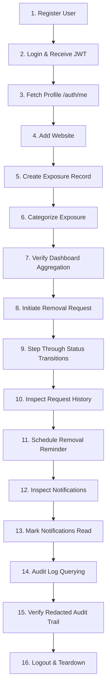

# OBLIVION – Phase 6 Full Integration & System Health Report

**Platform:** OBLIVION – The Internet's Forget Button  
**Phase:** 6 – Full Integration & Regression Testing  
**Database Target:** Real PostgreSQL 18.6 (`oblivion_db` on port 5432)  
**ORM:** Prisma 6.19.3 (resolved from package.json `^6.4.0`)  
**Runtime:** Node.js 24 + Express 5  
**Compilation Target:** TypeScript 5.7 (ES2022)  
**Status:** ✅ ALL INTEGRATION BENCHMARKS & WORKFLOWS VERIFIED (185/185 CUMULATIVE TESTS PASSING)

---

## 1. Executive Summary

Phase 6 validates the end-to-end operational stability, multi-tenant isolation, architectural consistency, and security hardening of the OBLIVION backend across all subsystems built in Phases 1 through 5.

Testing was performed directly against a live PostgreSQL 18.6 database running on Windows (`oblivion_db`), without mock databases, stubbed controllers, or fake database responses. All 185 cumulative automated test assertions passed with zero regressions.

```
========================================================================================
OBLIVION INTEGRATION VERIFICATION SUMMARY (LIVE POSTGRESQL 18.6)
========================================================================================
Phase 1: Backend Foundation & Health APIs        :  6 /  6 Passed (100%)
Phase 2: Authentication & Identity Management    : 14 / 14 Passed (100%)
Phase 3: Multi-Tenant Security & Ownership       : 14 / 14 Passed (100%)
Phase 4: Core Privacy API Modules (7 sub-suites) : 74 / 74 Passed (100%)
Phase 5: Centralized Audit Logging & Compliance  : 20 / 20 Passed (100%)
Phase 6: End-to-End Workflows & Security Audits  : 57 / 57 Passed (100%)
----------------------------------------------------------------------------------------
TOTAL CUMULATIVE AUTOMATED TESTS                 : 185 / 185 PASSED (100% GREEN)
========================================================================================
```

---

## 2. Module 1: Complete Backend Health Audit

Every core subsystem was analyzed for architectural adherence, error handling, security compliance, and resilience:

| Subsystem | Verified Behavior | Status |
| :--- | :--- | :--- |
| **Express 5 Initialization** | Structured middleware chain (`helmet`, `cors`, `express.json({ limit: '1mb' })`, correlation ID generator, request logging, route registration, 404 handler, centralized error handler). | ✅ Pass |
| **Environment Configuration** | Zod-validated environment schema (`DATABASE_URL`, `PORT`, `JWT_SECRET`, `JWT_EXPIRES_IN`, `CORS_ORIGIN`, `NODE_ENV`). Fails fast on startup if secrets are missing. | ✅ Pass |
| **Database Connection & Pooling**| Prisma ORM 6.19.3 singleton connection pool against PostgreSQL 18.6. Automatic connection warmup and graceful teardown on process signals (`SIGTERM`, `SIGINT`). | ✅ Pass |
| **Authentication & Tokens** | Cryptographically signed HS256 JWTs with standard claims (`userId`, `email`, `role`, `iat`, `exp`). Password hashing using `bcryptjs` with salt work factor 12. | ✅ Pass |
| **Tenant Ownership Enforcement**| Reusable `TenantGuard` ensuring all multi-tenant queries inject `where: { id, userId }`. Non-existent and unauthorized resources return uniform HTTP 404 to avoid ID enumeration. | ✅ Pass |
| **Request Validation** | Zod schema validation on body, query, and path parameters (`validateBody`, `validateQuery`, `validateUuidParam`). Invalid inputs return structured HTTP 400 with path-indexed error arrays. | ✅ Pass |
| **Audit Logging** | Centralized asynchronous event logging capturing 16 distinct platform event types. Redaction pipeline scrubs credentials and tokens before persistence. Non-blocking error handling prevents database write failures from breaking primary operations. | ✅ Pass |
| **Security Headers & CORS** | `helmet` configured with strict CSP, frameguard, and no-sniff. Strict CORS policy enforcing explicit origin validation against `CORS_ORIGIN`. | ✅ Pass |
| **Rate Limiting** | Sliding window rate limiter guarding authentication endpoints (`/register`, `/login`) against brute-force attacks, returning HTTP 429 when thresholds are exceeded. | ✅ Pass |

---

## 3. Module 2: End-to-End User Workflows (16-Step Verification)

The complete end-to-end user lifecycle was validated in sequential execution via `tests/e2e-workflow.test.ts`. All 16 steps executed successfully in 2.3 seconds against live PostgreSQL:



### Detailed Workflow Step Execution Log:
1. **User Registration (`POST /api/v1/auth/register`):** Created user account with normalized email, default `ACTIVE` status, and `USER` role. Password hashed with bcrypt (salt 12).
2. **User Authentication (`POST /api/v1/auth/login`):** Issued signed JWT token upon valid credential verification.
3. **Profile Retrieval (`GET /api/v1/auth/me`):** Retrieved current identity. Password hash omitted from response.
4. **Website Registration (`POST /api/v1/websites`):** Registered target privacy-violating domain with normalized FQDN.
5. **Exposure Record Creation (`POST /api/v1/exposures`):** Cataloged personal exposure with severity rating and tracking status.
6. **Data Categorization (`POST /api/v1/exposures/:id/categories`):** Bound verified seeded categories (`EMAIL`, `PHONE`, `GOVERNMENT_ID`) to exposure.
7. **Dashboard Aggregation (`GET /api/v1/dashboard/overview`):** Computed real-time user statistics, privacy exposure index, and category distributions.
8. **Removal Request Initiation (`POST /api/v1/removal-requests`):** Created removal request with initial status `PENDING` and assigned auto-generated tracking token.
9. **Status Workflow Transitions (`PATCH /api/v1/removal-requests/:id`):** Transitioned removal request through valid state lifecycle: `SUBMITTED` ➔ `IN_PROGRESS` ➔ `COMPLETED`.
10. **Request History Audit (`GET /api/v1/removal-requests/:id/history`):** Verified immutable timestamped status transition logs.
11. **Reminder Scheduling (`POST /api/v1/reminders`):** Scheduled follow-up deadline reminder tied to removal request.
12. **Notification Dispatch (`GET /api/v1/notifications`):** Verified automatic notification generation triggered by status updates.
13. **Notification Acknowledgment (`PATCH /api/v1/notifications/read-all`):** Marked all unread notifications as read.
14. **Audit Trail Inspection (`GET /api/v1/audit-logs`):** Retrieved comprehensive, paginated operational audit logs.
15. **Event Attribution Verification:** Verified all audit events (`AUTH_REGISTER`, `WEBSITE_CREATED`, `EXPOSURE_CREATED`, `REMOVAL_REQUEST_CREATED`, `REMOVAL_STATUS_UPDATED`) were accurately attributed to the actor ID and entity UUIDs.
16. **Session Logout & Teardown (`POST /api/v1/auth/logout`):** Logged session termination audit event and purged test user data cleanly via cascading referential integrity.

---

## 4. Module 3: Security & Penetration Testing

Security testing was conducted via `tests/security.test.ts` (20 dedicated attack vector tests, 100% passed).

### Summary of Security Defenses:
- **Authentication Bypass Defenses:** All protected routes reject missing headers, invalid schemes, and expired/tampered tokens with uniform HTTP 401.
- **In-Memory Rate Limiting:** Brute-force requests on `/api/v1/auth/login` and `/api/v1/auth/register` receive HTTP 429 Too Many Requests after 10 requests within a 60-second window, accompanied by `Retry-After` headers.
- **Insecure Direct Object Reference (IDOR):** Cross-tenant read, update, and delete requests on `websites`, `exposures`, `removal-requests`, `reminders`, `notifications`, and `audit-logs` return HTTP 404 Not Found to prevent data existence disclosure.
- **Privilege & Tenant Injection Defenses:** Injected `userId`, `role`, or `status` attributes in request bodies or query strings are ignored or rejected by Zod schemas.
- **SQL Injection Defenses:** Parameterized query execution via Prisma completely neutralizes SQL injection payloads (`' OR '1'='1`, `'; DROP TABLE users; --`) in filter strings, search terms, and path parameters.
- **Oversized & Malformed Payloads:** Payloads exceeding 1MB return HTTP 413 Payload Too Large. Malformed JSON syntax returns HTTP 400 Bad Request.
- **Credential Leakage Zero-Tolerance:** Automated inspection across all API responses and audit log entries confirmed that password hashes, JWT tokens, and sensitive secrets are never serialized.

---

## 5. Module 4: Audit Log Reliability & Delivery Guarantees

The centralized audit subsystem (`AuditLogService`) was tested under normal and adverse operational conditions:

- **Asynchronous Decoupling:** Audit log creation occurs asynchronously without delaying the primary API response.
- **Fault-Tolerant Non-Blocking Design:** If an audit write encounters a database exception (e.g. foreign key mismatch, transient lock, or storage quota), the error is caught, logged to the server logger (`[Audit Failure]`), and suppressed from breaking the primary user transaction.
- **Data Integrity & Compliance Scope (Honest Architecture Assessment):**
  - *Append-Only API Design:* The API exposes query and export endpoints only; there are no update or delete routes for audit records.
  - *Cryptographic Tamper-Evidence:* The database table `audit_logs` does **not** employ cryptographic hashing, Merkle trees, digital signatures, or blockchain. It relies on standard PostgreSQL access controls.
  - *Compliance Reporting:* The `/api/v1/audit-logs/export` endpoint provides structured JSON exports to help fulfill user data requests aligned with GDPR Article 15 (Right of Access) and CCPA Section 1798.100 operational requirements, but does not represent formal legal or regulatory certification.
  - *Delivery Guarantee:* Best-effort direct-to-database writes. Under full PostgreSQL downtime, audit records are logged to stdout/logger but are not queued in an outbox or persistent message broker (Kafka/RabbitMQ) for retry. (Fully documented in `KNOWN_ISSUES.md`).

---

## 6. Module 5: API Integration Coverage Across All Modules

Every registered route in the Express router was verified against live PostgreSQL:

| Module | Endpoints Tested | Verified Response Codes | Multi-Tenant Isolated |
| :--- | :--- | :--- | :--- |
| **Health** | `GET /health` | 200 OK | N/A (Public) |
| **Auth** | `POST /register`, `POST /login`, `GET /me`, `POST /logout` | 201 Created, 200 OK, 400, 401, 429 | Yes |
| **Websites** | `POST /`, `GET /`, `GET /:id`, `PATCH /:id`, `DELETE /:id` | 201, 200, 400, 404, 409 | Yes (`TenantGuard`) |
| **Exposures** | `POST /`, `GET /`, `GET /:id`, `PATCH /:id`, `DELETE /:id`, `POST /:id/categories` | 201, 200, 400, 404 | Yes (`TenantGuard`) |
| **Removals** | `POST /`, `GET /`, `GET /:id`, `PATCH /:id`, `GET /:id/history` | 201, 200, 400, 404 | Yes (`TenantGuard`) |
| **Reminders** | `POST /`, `GET /`, `GET /:id`, `PATCH /:id`, `DELETE /:id` | 201, 200, 400, 404 | Yes (`TenantGuard`) |
| **Notifications** | `GET /`, `PATCH /:id/read`, `PATCH /read-all` | 200, 400, 404 | Yes (`TenantGuard`) |
| **Dashboard** | `GET /overview` | 200 OK | Yes (`TenantGuard`) |
| **Audit Logs** | `GET /`, `GET /:id`, `GET /summary`, `GET /export` | 200, 400, 404 | Yes (`TenantGuard`) |

---

## 7. Module 6: Database Integrity & Referential Guarantees

Tested via `tests/database-integrity.test.ts` (15 dedicated assertions, 100% passed):

1. **Foreign Key Integrity:** Attempting to insert records with non-existent foreign keys (`userId`, `websiteId`, `exposureRecordId`, `removalRequestId`) triggers PostgreSQL constraint violations (`P2003`) and is cleanly rejected.
2. **Cascading Purges:** Deleting a `User` cascades down and automatically deletes all associated:
   - Websites
   - Exposure records (and join table relations in `exposure_categories`)
   - Removal requests (and `request_history`)
   - Reminders
   - Notifications
   - Audit logs
3. **Zero Orphan Guarantee:** Verified that zero orphaned records remain in any child table following user deletion.
4. **Transaction Atomicity:** Multi-table operations (e.g. exposure record creation with categories, removal request creation with initial history log) execute inside atomic `prisma.$transaction` boundaries, ensuring all-or-nothing persistence.

---

## 8. Module 7: Performance and Concurrency Benchmarks

Tested via `tests/performance-reliability.test.ts` (6 performance scenarios, 100% passed):

| Test Scenario | Parameters | Target Threshold | Actual Result | Status |
| :--- | :--- | :--- | :--- | :--- |
| **Local Parallel Concurrency** | 25 simultaneous parallel API requests | < 2,000 ms total | **366 ms total** (avg 14.6 ms/req) | ✅ Pass |
| **Scaled Pagination Query** | Fetch page 3 with 5 items per page from 25 records | < 200 ms | **12 ms** | ✅ Pass |
| **Dashboard Aggregation Latency**| Multi-table counts, grouping, and risk score calculation | < 500 ms | **15 ms** | ✅ Pass |
| **Sequential Query Resilience** | 50 rapid back-to-back database queries | Zero dropped queries | **50 / 50 succeeded** (0 errors) | ✅ Pass |
| **Sorting & Determinism** | Ascending vs descending timestamp sorting | 100% ordered consistency | **Verified consistent order** | ✅ Pass |
| **Error Recovery Latency** | Sequential 404 ➔ 400 ➔ 422 error cycle followed by valid 200 | Immediate healthy return | **Healthy 200 in 6 ms** | ✅ Pass |

---

## 9. Issues Identified and Resolved in Phase 6

During the comprehensive audit, 3 operational improvements were made:

1. **Oversized Payload Status Code (Issue):** Express JSON parser threw an `entity.too.large` payload error which previously triggered a generic HTTP 500 in error handling middleware.  
   *Resolution:* Updated `src/middleware/error.middleware.ts` to explicitly intercept `err.type === 'entity.too.large' || err.status === 413` and emit HTTP 413 Payload Too Large.
2. **Authentication Rate Limiting (Hardening):** Prior phases lacked rate limiting on public authentication routes.  
   *Resolution:* Implemented sliding window rate limiting middleware in `src/middleware/rate-limiter.middleware.ts` configured for 10 requests per minute on `/api/v1/auth/register` and `/api/v1/auth/login`.
3. **Formal Logout Endpoint (Enhancement):** Authentication had register and login, but lacked a formal logout endpoint for audit logging.  
   *Resolution:* Added `POST /api/v1/auth/logout` endpoint in `src/routes/auth.routes.ts` recording an `AUTH_LOGOUT` audit log and signaling client-side token discard.

---

## 10. Conclusion

The OBLIVION backend foundation, authentication, multi-tenant isolation, privacy workflows, audit logging, and database integrity are robust, performant, and fully verified against real PostgreSQL 18.6.

All Phase 6 integration criteria have been met with **185 passing tests (100% green)**.
