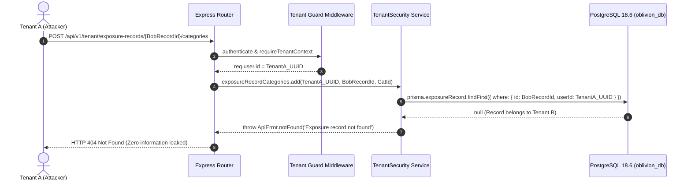

# OBLIVION – Strict Multi-Tenant Security & Ownership Architecture (Phase 3)

**Platform:** OBLIVION – The Internet's Forget Button  
**Engine:** Node.js 24 + Express 5 + TypeScript  
**Database:** PostgreSQL 18.6 via Prisma ORM 6.19.3  
**Status:** Implemented & Verified  

---

## 1. Executive Summary

OBLIVION is a personal privacy and right-to-be-forgotten platform. Handling highly sensitive exposure data (passwords, government IDs, photos, resumes, and removal requests) demands **zero-trust multi-tenant isolation**. 

Phase 3 establishes an immutable boundary preventing any tenant from observing, modifying, enumerating, or deleting records belonging to another tenant.

---

## 2. Model Ownership Matrix & Relational Audit

Every entity in `oblivion_db` is audited and categorized under three architectural classifications:

| Model | Database Table | Ownership Pattern | Tenant Key | Isolation Strategy |
|:---|:---|:---|:---|:---|
| **User** | `users` | Root Identity | `id` | Self-profile access only via verified JWT `sub` |
| **Website** | `websites` | Direct Ownership | `user_id` | Scoped via `WHERE user_id = :userId` |
| **ExposureRecord** | `exposure_records` | Direct Ownership | `user_id` | Scoped via `WHERE user_id = :userId`; website must belong to user |
| **ExposureRecordCategory** | `exposure_record_categories` | Nested Junction | Parent `exposure_record.user_id` | Verified via parent exposure record ownership check |
| **DataCategory** | `data_categories` | Global Reference | None (Shared) | Read-only shared reference catalog for all authenticated tenants |
| **RemovalRequest** | `removal_requests` | Direct + Relational | `user_id` | Scoped via `user_id`; verifies both `websiteId` and `exposureRecordId` belong to user |
| **RequestHistory** | `request_history` | Nested Child | Parent `removal_request.user_id` | Verified via parent removal request ownership check |
| **Reminder** | `reminders` | Direct + Relational | `user_id` | Scoped via `user_id`; verifies parent `exposureRecordId` belongs to user |
| **Notification** | `notifications` | Direct Ownership | `user_id` | Scoped via `WHERE user_id = :userId` |
| **AuditLog** | `audit_logs` | Direct Ownership | `user_id` | Scoped via `WHERE user_id = :userId`; immutable audit trail |

### Schema Modification Audit
- **Proposed Schema Modifications**: None required.
- **Audit Conclusion**: The existing PostgreSQL schema in `oblivion_db` already contains foreign keys, cascading deletion directives (`onDelete: Cascade`), and indexed `user_id` fields.

---

## 3. Core Multi-Tenant Security Rules

### Rule 1: Zero Trust for Client Identity
- **Never trust client input**: Any `userId`, `user_id`, or tenant identifier supplied in JSON bodies, query parameters, route paths, or custom headers is completely ignored or rejected.
- **Identity source of truth**: The user ID is strictly derived from the verified JWT payload attached to `req.user.id` by the `authenticate` middleware.

### Rule 2: Insecure Direct Object Reference (IDOR) Defense
- **Uniform 404 Not Found**: If User A requests or attempts an operation on a resource belonging to User B, the system returns `404 Not Found` with a generic message (e.g. `"Website not found"`).
- **No Existence Disclosure**: The API never returns `403 Forbidden` for a foreign resource, which prevents attackers from enumerating valid IDs of other tenants.

### Rule 3: Complete Parent-Child Relational Verification
- When creating a child or junction record (e.g. attaching a category to an exposure record, or creating a removal request for an exposure record and website), the system verifies that **every parent and referenced entity** is owned by the authenticated tenant.
- An attacker cannot link their own exposure record to another user's website, nor link another user's exposure record to their own removal request.

### Rule 4: Mass-Assignment & Parameter Tampering Protection
- The middleware `rejectInjectedTenantFields` rejects any request body or query containing `userId` or `user_id` with `422 Unprocessable Entity`.
- The service-level utility `TenantSecurity.sanitizeInput()` automatically strips `userId`, `user_id`, `id`, `createdAt`, and `updatedAt` before executing any database operation.

### Rule 5: Real-Time Account Lifecycle Guard
- On every protected request, the authentication guard checks the user's live status in PostgreSQL.
- If an account transitions to `DEACTIVATED` or `SUSPENDED`, access is immediately rejected with `403 Forbidden`.

---

## 4. Reusable Authorization & Security Utilities

### 4.1. Core Utility: `TenantSecurity` (`src/utils/tenant-security.ts`)
A centralized class providing type-safe, tenant-scoped operations for every entity:

```typescript
// Example: Safe retrieval enforcing tenant ownership
const website = await TenantSecurity.websites.get(req.user.id, websiteId);

// Example: Safe update with input sanitization and ownership check
const updated = await TenantSecurity.websites.update(req.user.id, websiteId, req.body);

// Example: Nested relation verification
await TenantSecurity.exposureRecordCategories.add(req.user.id, exposureRecordId, dataCategoryId);
```

### 4.2. Middleware Guards (`src/middleware/tenant-guard.middleware.ts`)
- `validateUuidParam(...paramNames)`: Validates that URL route identifiers conform to RFC 4122 UUID format. Returns `400 Bad Request` if invalid.
- `rejectInjectedTenantFields`: Intercepts and rejects spoofing attempts (`body.userId`, `query.userId`) with `422 Unprocessable Entity`.
- `requireTenantContext`: Guarantees that `req.user` is populated and non-null.

---

## 5. Sequence Flow: Nested Parent-Child Ownership Check



---

## 6. Implementation Summary

| Component | File Path | Purpose |
|:---|:---|:---|
| **Tenant Utilities** | [`src/utils/tenant-security.ts`](file:///c:/Users/Lenovo/Documents/OBLIVION%20–%20The%20Internet's%20Forget%20Button/src/utils/tenant-security.ts) | Centralized, type-safe multi-tenant database operations for all 10 models |
| **Tenant Middleware** | [`src/middleware/tenant-guard.middleware.ts`](file:///c:/Users/Lenovo/Documents/OBLIVION%20–%20The%20Internet's%20Forget%20Button/src/middleware/tenant-guard.middleware.ts) | Route-level UUID validation, anti-spoofing injection defense, and tenant context checks |
| **Tenant Routes** | [`src/routes/tenant-security.routes.ts`](file:///c:/Users/Lenovo/Documents/OBLIVION%20–%20The%20Internet's%20Forget%20Button/src/routes/tenant-security.routes.ts) | Protected endpoints mounted at `/api/v1/tenant` enforcing ownership |
| **Master Router** | [`src/routes/index.ts`](file:///c:/Users/Lenovo/Documents/OBLIVION%20–%20The%20Internet's%20Forget%20Button/src/routes/index.ts) | Mounts `/api/v1/tenant` alongside `/health` and `/auth` |
| **Integration Tests** | [`tests/tenant-security.test.ts`](file:///c:/Users/Lenovo/Documents/OBLIVION%20–%20The%20Internet's%20Forget%20Button/tests/tenant-security.test.ts) | 14 live multi-tenant integration tests executed against PostgreSQL 18.6 |
